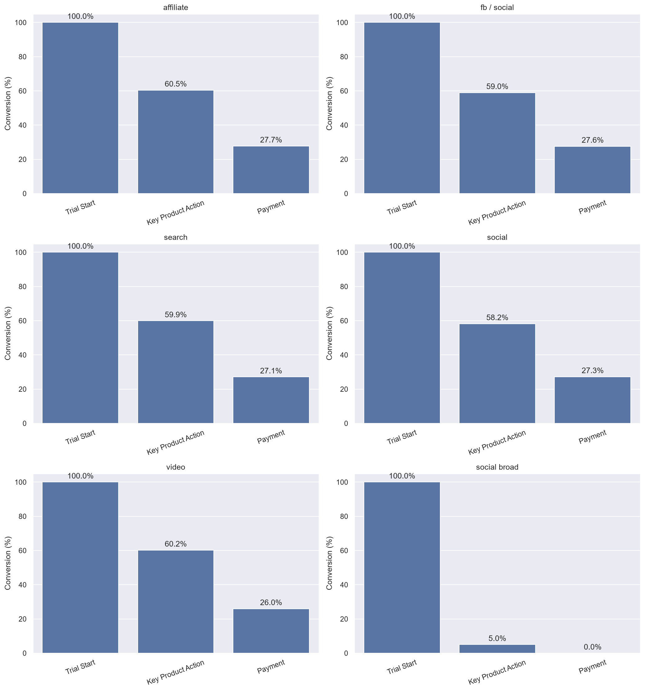
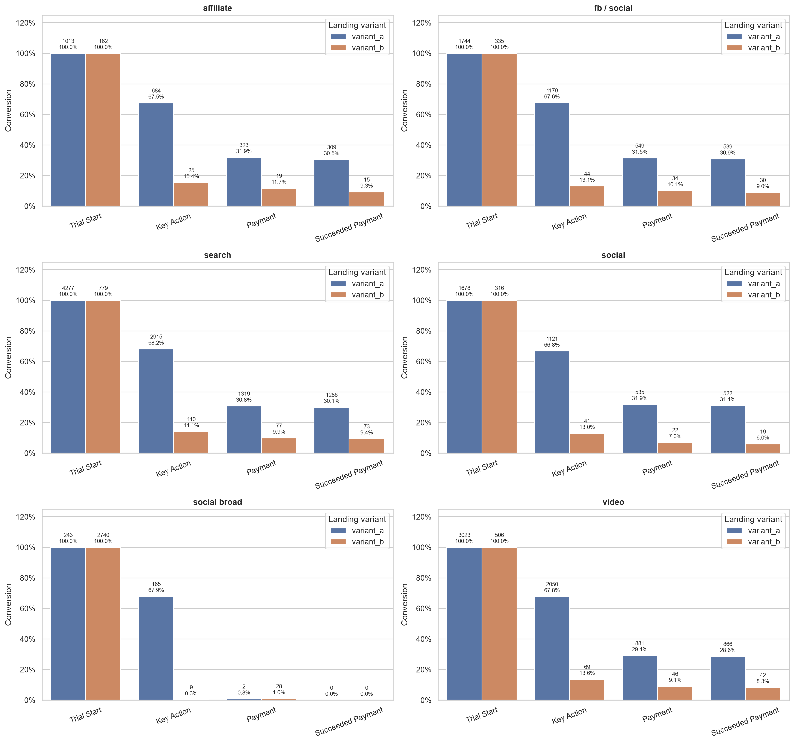
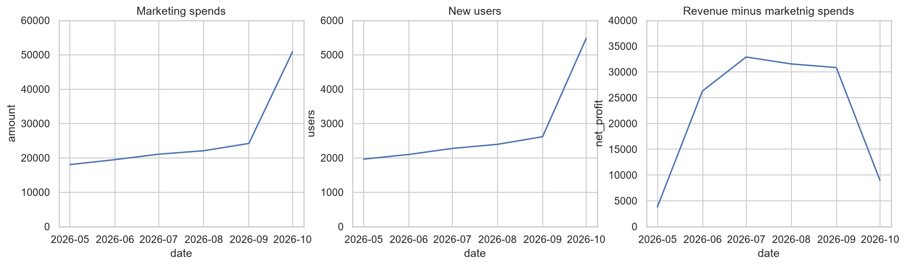
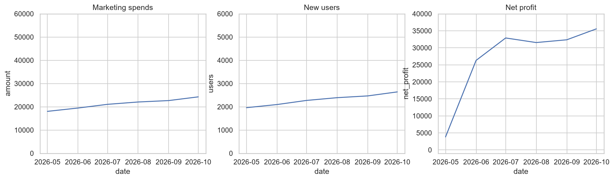
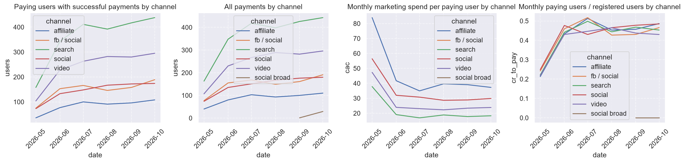
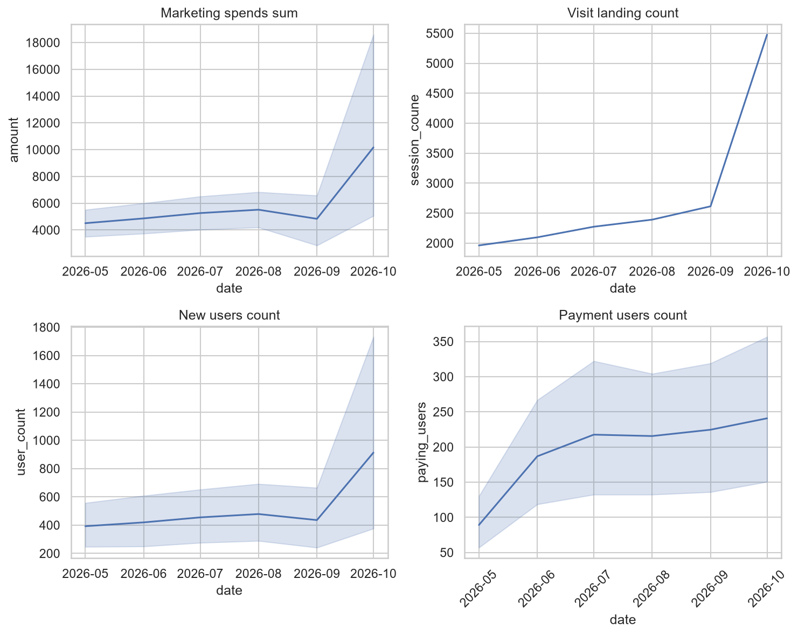
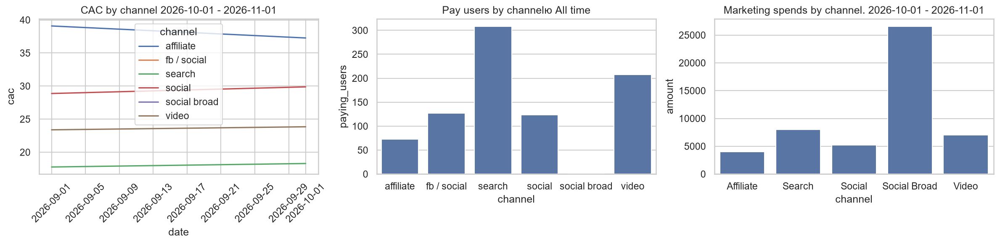

# EdTech Acquisition Funnel Analysis

**Portfolio Project · Product Analytics / Data Analysis**

Investigating acquisition funnel performance, landing-page conversion, and marketing efficiency using PostgreSQL and Python.

- **Analysis period:** May 1 – October 31, 2026
- **Tools:** PostgreSQL, Python, Pandas, Matplotlib, Seaborn, Jupyter Notebook
- **Data:** Synthetic dataset created for analytical practice

## Business Problem

Over the last month:

- Marketing spending increased by **65%**.
- Landing page visits increased by **60%**.
- Registrations increased by **55%**.
- The number of new paying users increased by only **2%**.

We need to understand why growth in acquisition is not leading to a comparable increase in sales and identify opportunities to improve marketing efficiency.

The indicators above define the initial business context. **The rest of the analysis should not be predetermined.**

## Project Objective

Investigate the acquisition funnel from the first landing-page visit to successful payment, identify stages with weaker conversion, and explore differences across acquisition channels and landing-page variants.

The investigation begins with data validation and exploration rather than assuming a particular cause.

## Key Findings and Investigation Areas

The current analysis highlights three areas that require attention:

- **Acquisition channel performance:** The current channel-level results show no successful paying users attributed to `social broad`. Payment records, marketing costs, and attribution logic must be considered when interpreting this result.
- **Landing-page conversion:** The available summaries show substantially different conversion patterns between Variant A and Variant B. Further validation is needed before attributing the difference to the landing page itself.
- **Monthly performance:** The October summary shows a sharp increase in recorded landing visits without a corresponding increase in paying users. The underlying counts and funnel definitions should be validated before drawing a business conclusion.

These are observations from the current analysis outputs, not independently verified findings from a real business.

## Key Visualizations

### 1. Acquisition Funnel by Channel

Compare user counts and conversion rates across acquisition channels to identify differences in funnel performance.

### 2. Funnel by Channel and Landing-Page Variant

Explore whether conversion patterns differ between landing-page variants overall and within individual acquisition channels.

### 3. Investigation of the Underperforming Channel

Examine the channel with no recorded successful payments and assess how its inclusion affects the overall funnel comparison.

### 4. Data Validation and Fact Checks

Inspect channel classifications, investigate unexpected results, and validate marketing cost data before interpreting the findings.

## Analysis Approach

The project follows an evidence-based workflow:

1. **Data validation** — inspect date ranges, record counts, missing values, category labels, payment statuses, and marketing costs.
2. **Funnel analysis** — compare absolute user counts and conversion rates at each stage.
3. **Channel comparison** — investigate differences in acquisition performance and advertising spend per paying user.
4. **Landing-page investigation** — compare variants overall and across acquisition channels.
5. **Fact checking** — investigate unexpected results against underlying payment records and attribution logic.
6. **Recommendations** — identify potential actions supported by the available evidence and document remaining uncertainties.

## Funnel Definition

The intended funnel consists of the following stages:

`Landing visit → Registration → Trial start → Key product action → Successful payment`

Funnel counts and conversion rates should be interpreted together. Each conversion rate must specify its numerator, denominator, date range, and population.

Where the data does not support a reliable comparison between stages, this limitation should be documented rather than assuming that the stages are directly comparable.

## Dataset

The project uses synthetic data generated for analytical practice.

| File | Description |
|---|---|
| `users.csv` | User registration dates, acquisition channels, campaigns, landing-page variants, devices, and countries |
| `web_sessions.csv` | Session information and UTM attributes |
| `events.csv` | Landing visits, registrations, trial starts, and key product actions |
| `subscriptions.csv` | Subscription statuses and trial/subscription dates |
| `payments.csv` | Payment dates, amounts, statuses, and payment methods |
| `marketing_spend.csv` | Daily advertising spend, impressions, and clicks by campaign |

## Tools and Techniques

- **PostgreSQL:** joins, aggregations, data validation, and funnel calculations.
- **Python and Pandas:** data processing and analysis.
- **Matplotlib and Seaborn:** data visualization.
- **Jupyter Notebook:** documenting the investigation, validation steps, and conclusions.

## Limitations and Interpretation

- **Synthetic data:** The results demonstrate an analytical workflow and must not be presented as findings from a real company.
- **Attribution:** A user’s assigned acquisition channel may not fully represent the actual cause of conversion. Missing UTM attributes and duplicate events can affect interpretation.
- **Zero recorded payments:** A channel with no successful payments has no finite spend-per-paying-user value for the selected period. The result should be reported as undefined rather than as a numerical CAC.
- **CAC interpretation:** Advertising spend divided by distinct paying users is a limited acquisition-cost measure. It should not automatically be treated as full Customer Acquisition Cost if other acquisition costs are unavailable.
- **Landing-page comparisons:** Differences between variants indicate an association, not causation. An appropriate experimental design is needed to establish a causal effect.
- **Data consistency:** Unexpected monthly counts and funnel relationships must be validated against the source records and SQL logic before they support final business recommendations.
- **Profitability:** Revenue after advertising spend is not net profit because other business costs are not included.

## Project Deliverables

- SQL queries for data validation and funnel analysis.
- A Jupyter Notebook documenting the investigation and visualizations.
- An evidence-based assessment of acquisition channels and landing-page variants.
- Recommendations and limitations grounded in the available data.

## Project Status

**Portfolio project focused on acquisition funnel analysis, data validation, and marketing efficiency.**

The final business recommendations should be based on validated results rather than preliminary observations alone.